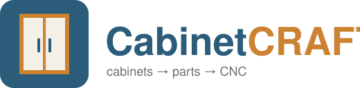
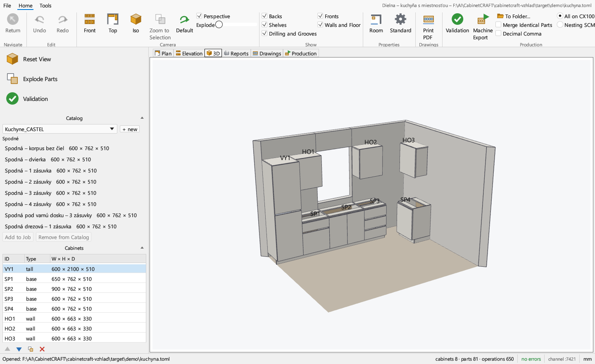
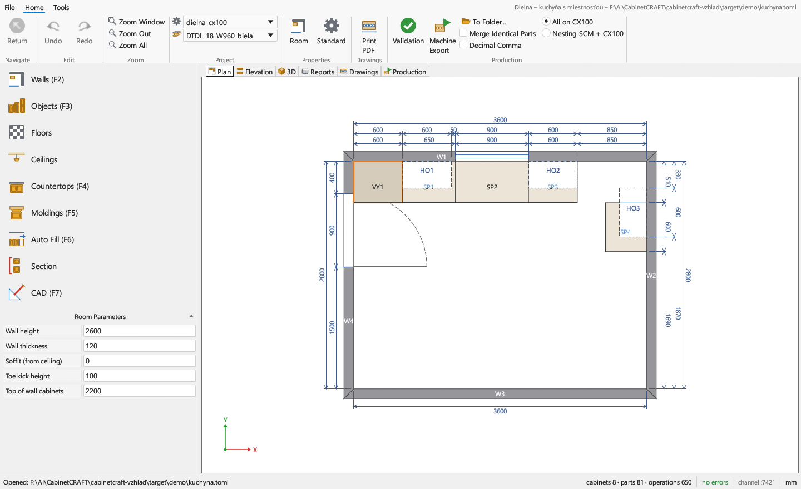
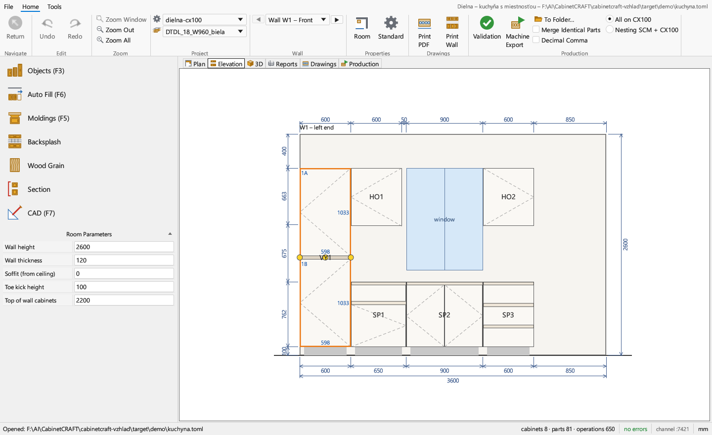
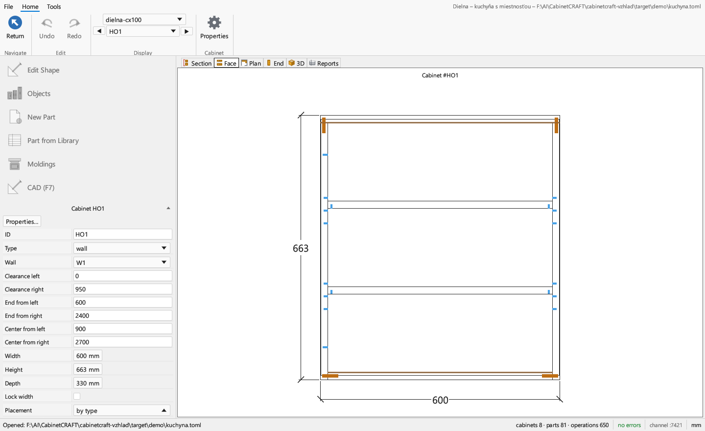
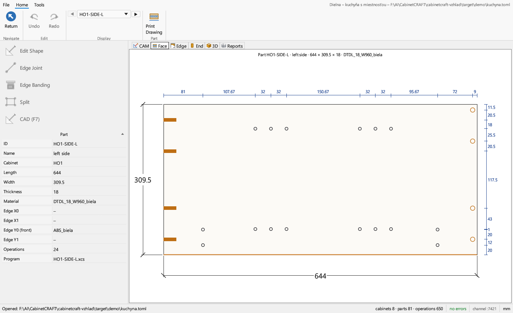

<div align="center">



**Design frameless cabinets in 3D and send them straight to the CNC.**<br>
Room → cabinets → parts → joints and hardware → cut lists, labels and machine programs.

[](https://www.rust-lang.org/)
[](#quick-start)
[](#license)
[](locales/README.md)
[](#what-works-today)

[Screenshots](#screenshots) · [Why](#why-cabinetcraft) · [What works](#what-works-today) · [Quick start](#quick-start) · [Machines](#machine-output) · [Automation](#drive-it-from-scripts-and-agents) · [Architecture](#architecture) · [Translate](#translations) · [Roadmap](#roadmap)

🇸🇰 [Slovenská verzia](README.sk.md)

</div>

---

## Screenshots

<table>
  <tr>
    <td width="50%"><br><sub><i>3D view of the example kitchen (<code>examples/dielna/kuchyna.toml</code>): walls, floor, cabinets with fronts.</i></sub></td>
    <td width="50%"><br><sub><i>Floor plan with the mode list (Walls F2, Objects F3, … CAD F7), room parameters and dimensions.</i></sub></td>
  </tr>
  <tr>
    <td><br><sub><i>Wall elevation: drag cabinets along the wall, resize them by their edges, split fronts with a right click.</i></sub></td>
    <td><br><sub><i>One cabinet opened on its own: Section, Face, Plan, End, 3D and Reports – every hole and dowel visible.</i></sub></td>
  </tr>
  <tr>
    <td colspan="2"><br><sub><i>One board opened on its own: CAM work planes, face with hole-position dimension chains, edges, 3D and the list of operations that go to the machine.</i></sub></td>
  </tr>
</table>

## Why CabinetCRAFT

A small cabinet shop needs one thing from its software: **the parts that come off the saw and the CNC must be right**. CabinetCRAFT is built around that.

- **One `.exe`, nothing to install.** Pure Rust, runs on an ordinary Windows PC, opens in a second.
- **The shop's construction standard is data, not code.** Panel thickness, back grooves, dowel layout, shelf-pin rows, hinges and drawer runners live in a readable TOML file. Every value carries its origin: `[P]` taken from real programs, `[U]` confirmed by the shop, `[?]` a guess to check.
- **The workflow carpenters already know.** The layout follows the program many shops grew up on: floor plan with modes, wall elevation, a cabinet opened on its own, a board opened on its own, a ribbon with *Return* and *Zoom*. Icons and texts are our own.
- **Machine safety first.** Validation blocks export when a part would not fit the machine, a hole is too deep for the board or a tool is missing. Templates that have not been proven on the real machine stay marked `verified = false`.
- **Never lose work.** No `unwrap`/`panic` in production code, every edit is an undoable command, a failing command rolls back.
- **Translatable by anyone.** Every text is in [`locales/`](locales/README.md); a new language is one TOML file, no build needed.

## What works today

| Area | What you get | Status |
|---|---|---|
| **Room** | walls (line or rectangle), windows and doors, room parameters, cabinets snapped to walls, corner tools, auto fill of free wall space | ✅ |
| **Cabinets** | base, wall, tall; fronts (doors, pairs, drawers, false fronts, open), sections split like in a face frame editor, shelves, toe kick, fillers, niches, slanted cabinets, blind corners, LED rails | ✅ |
| **Catalog** | shop catalogs in `catalogs/*.toml`, drag an item onto a wall, save a cabinet back to the catalog | ✅ |
| **Joints & hardware** | dowels, confirmat screws, back-panel groove, shelf-pin rows, Blum hinges with plates, Merivobox drawers, TIP-ON | ✅ |
| **Views** | floor plan, wall elevation, GPU 3D (DirectX 12, CPU fallback), cabinet editor, board editor with CAM work planes | ✅ |
| **Outputs** | cut list CSV, `model.json`, PDF drawings (job, walls, cabinets, parts), part labels 80 × 80 / 100 × 80 mm with Code 39 barcode | ✅ |
| **SCM CX100** | Maestro `.xcs` per part + `RUN.bat` for XConverter | ✅ format matches real programs · ⚠️ prove on your machine first |
| **SCM nesting** | sheet layout (MaxRects + annealing), sheet programs, work split nesting / CX100, `CncRun.txt`, sheet labels in cut order | ✅ · ⚠️ `verified = false` |
| **WoodWOP** | `.mpr` from templates (alternative output) | 🟡 `BohrHoriz`/`Nuten` unverified |
| **CABINET VISION jobs** | open `.cvj` jobs directly; save writes `NAME_cabinetcraft.cvj` next to the original (the original is never touched) | 🧪 experimental |
| **Languages** | English, Slovak; more via `locales/*.toml` | ✅ |

> [!WARNING]
> A wrong CNC program can break a tool or damage the machine. Before the first real cut, run the generated programs on a test part and check the origin, axis directions and groove width. Every machine template that has not been confirmed on a real machine is marked `verified = false`.

## Quick start

You need [Rust](https://rustup.rs/) (stable) on Windows 10/11.

```sh
git clone https://github.com/LaMka21/CabinetCRAFT.git
cd CabinetCRAFT
cargo build --release -p cc-app
target\release\cabinetcraft-app.exe examples\dielna\kuchyna.toml
```

The first start opens the example kitchen; after that the last project opens. You can also start it with a `.cvj` job: `cabinetcraft-app.exe job.cvj`.

| Where | How |
|---|---|
| Floor plan | **F2** walls, **F3** objects, **F6** auto fill; *Return* goes back to the mode list |
| 3D | left mouse rotate · right mouse pan · wheel zoom · click = cabinet, second click = part |
| Any cabinet | double-click it (plan, elevation or 3D) to open it on its own |
| Any board | double-click it inside the cabinet editor |
| Machine export | *Validation* → *Machine Export* (blocked while validation reports errors) |
| Language | *Tools* → *Language* |

Command line, no window:

```sh
cargo run -p cc-cli -- build examples/dielna/project.toml --out out
```

writes `cutlist.csv`, `model.json`, `xcs/*.xcs` + `RUN.bat` and labels. Validation errors stop the build with exit code 1.

## Machine output

| Output | Where it comes from | Notes |
|---|---|---|
| `xcs/<part>.xcs` + `RUN.bat` | `[xcs]` in `machine.toml` | SCM Maestro for CX100; `RUN.bat` converts to `.pgmx` with XConverter on the machine PC |
| `nesting/<mat><sheet>N.xcs`, `CncRun.txt` | `[nesting]`, `production.mode = "nesting"` | the nesting cuts the outline and drills the face that is up, the CX100 does edges, grooves and the face that is down |
| `mpr/<part>.mpr` | `[mpr]` | WoodWOP, alternative |
| `labels/*.pdf` | `[labels]` | label size and print order like the shop's label program |

The whole format of every program lives in templates inside the machine profile, so a new machine is a new TOML file. Example profiles: [`examples/dielna/machine.toml`](examples/dielna/machine.toml), [`machine-nesting.toml`](examples/dielna/machine-nesting.toml), [`examples/machines/woodwop-vzor.toml`](examples/machines/woodwop-vzor.toml).

## Drive it from scripts and agents

Every user action is a **command** (`cabinet.add`, `wall.set`, `front.split`, `project.export_cvj`, …). The ribbon, panels, keyboard shortcuts, the CLI and a local JSON control channel all call the same commands, so anything you can click you can script.

```sh
cabinetcraft-app.exe --control 7417 kuchyna.toml      # window + control channel
cabinetcraft serve kuchyna.toml --control 7417        # headless
cabinetcraft run kuchyna.toml --script steps.jsonl    # batch script
cabinetcraft commands                                 # list all commands
```

```json
{"id":1,"method":"engine.execute","params":{"command":"cabinet.add","params":{"type":"base","w":600}}}
{"id":2,"method":"ui.screenshot","params":{"path":"C:/tmp/shot.png"}}
```

Protocol: [`docs/control-protocol.md`](docs/control-protocol.md). AI agents working on the code start with [`CLAUDE.md`](CLAUDE.md).

## Architecture

Layers are checked by `cargo xtask layers`; nothing below the app layer depends on the GUI.

| Layer | Crates | Role |
|---|---|---|
| L0 | `cc-model`, `cc-i18n` | types (project, standard, parts, operations), translations |
| L1 | `cc-config`, `cc-generate`, `cc-joints`, `cc-validate`, `cc-room`, `cc-nest`, `cc-import-cvj` | loading and checking files, cabinet → parts, joints → operations, validation, room geometry, nesting, `.cvj` reading |
| L2 | `cc-out-*`, `cc-scene` | CSV, `.xcs`, `.mpr`, PDF, `.cvj` writing; 3D scene and CPU renderer |
| L3 | `cc-pipeline` | project → model → validation → outputs |
| L4 | `cc-engine` | session, commands, undo/redo |
| L5 | `cc-control` | JSON control channel |
| app | `cc-app`, `cc-cli` | the window (egui + wgpu) and the command line |

Conventions: millimetres, right-handed axes, part face **F** always faces the cabinet interior, the banded front edge is always **Y0**. Outputs are deterministic – the same input gives byte-identical programs, checked by golden tests.

```sh
cargo xtask ci     # fmt, clippy -D warnings, tests, layers, translations
```

## Translations

The interface ships in **English** and **Slovak**. Adding your language takes a text editor and no Rust:

1. copy [`locales/en.toml`](locales/en.toml) to `<code>.toml` (`de.toml`, `pl.toml`, `pt-BR.toml`, …),
2. translate the texts in quotes, keep the keys,
3. drop the file into the `locales` folder next to the program and pick it in *Tools* → *Language*,
4. send a pull request.

Details and the check that finds missing keys: [`locales/README.md`](locales/README.md).

## Roadmap

- [ ] machine test of the CX100 and nesting programs, then `verified = true`
- [ ] countertops, moldings, splash and ceilings (layout is in place, function is not)
- [ ] shaped (non-rectangular) parts and slanted doors
- [ ] manual operations in the board editor (CAM)
- [ ] hardware list in CSV/PDF, handles, front collision checks
- [ ] Windows installer and signed releases

## License

Licensed under either of

- Apache License, Version 2.0 ([LICENSE-APACHE](LICENSE-APACHE))
- MIT license ([LICENSE-MIT](LICENSE-MIT))

at your option. Unless you explicitly state otherwise, any contribution you submit is dual-licensed as above, without any additional terms.

CABINET VISION is a trademark of Hexagon. CabinetCRAFT is an independent project, not affiliated with or endorsed by Hexagon; it reads and writes job files only to work alongside an existing installation. Blum, TIP-ON, Merivobox, SCM, Maestro and WoodWOP are trademarks of their respective owners.

<div align="center"><sub>Made in a small Slovak cabinet shop, for cabinet shops.</sub></div>
